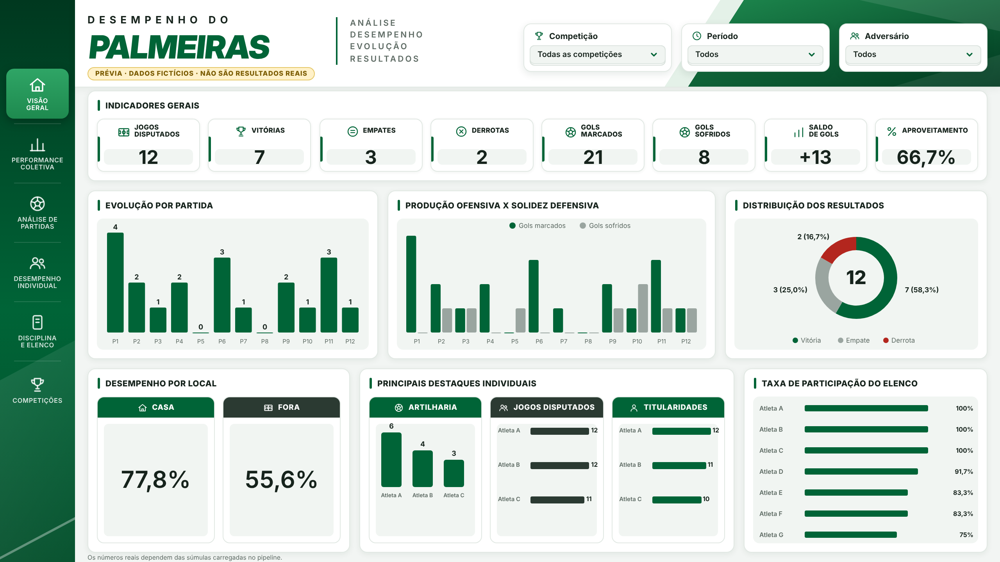

# Desempenho do Palmeiras

Análise de desempenho esportivo do **Palmeiras (time profissional)**, desenvolvida com
**Python e Power BI** a partir de súmulas oficiais. O projeto transforma registros de
partidas, jogadores, gols, cartões e substituições em um painel interativo com seis páginas,
com **filtro de competição** (Paulistão, Libertadores, Brasileirão, Copa do Brasil e outras).

> Projeto independente de portfólio, sem vínculo oficial com o Palmeiras, a CBF, a FPF ou a CONMEBOL.
> Os indicadores representam as partidas carregadas, não necessariamente a temporada completa.

## Visual (verde e branco)



*Prévia com dados fictícios, só para mostrar o design.*

## O que o projeto entrega

- **Identidade visual pronta:** fundos das 6 páginas (`dashboard/fundos/`), tema de cores
  (`dashboard/tema/`) e mapa de posições de cada visual (`docs/layout_posicoes.md`).
- **Pipeline Python** que lê súmulas em PDF, reconstrói cada tabela e audita a consistência.
- **Modelo estrela** (competição, partida, jogador, calendário + gols, cartões, substituições, participações).
- **Consultas Power Query (M)** e **~70 medidas DAX** prontas para copiar.
- **Roteiro de seis páginas**: Visão Geral, Performance Coletiva, Análise de Partidas,
  Desempenho Individual, Disciplina e Elenco, Comparativo entre Competições.

## Fontes por competição

O filtro de competição funciona para qualquer jogo que esteja nas tabelas. O que muda é
**como cada competição entra**:

| Competição        | Fonte da súmula | Como entra no projeto |
|-------------------|-----------------|-----------------------|
| Brasileirão Série A | CBF           | Automático: o extrator lê o PDF (layout validado) |
| Copa do Brasil    | CBF             | Automático, mesmo extrator. **Valide com 1 PDF** antes de carregar todos |
| Paulistão         | FPF             | Importação manual (CSV) ou novo parser, a partir de um PDF de exemplo |
| Libertadores      | CONMEBOL        | Importação manual (CSV) ou novo parser, a partir de um PDF de exemplo |

As súmulas da CBF estão em cada página de jogo, na aba **Documentos**. FPF e CONMEBOL usam
modelos de súmula diferentes, que ainda não foram mapeados aqui. Veja `dados/manual/LEIA-ME.md`.

## Estrutura do repositório

```
palmeiras-performance-hub/
├── README.md
├── requirements.txt
├── .gitignore
├── dashboard/
│   ├── fundos/                 # PNGs de fundo das 6 páginas (2560x1440) + prévia
│   ├── tema/                   # tema do Power BI (verde e branco)
│   └── design/gerar_fundos.py  # regenera os fundos e docs/layout_posicoes.md
├── imagens/                    # prints das páginas para este README
├── dados/
│   ├── brutos/                 # súmulas em PDF (não versionadas)
│   ├── manual/                 # CSVs de competições sem súmula CBF (modelos prontos)
│   ├── referencia/competicoes.csv
│   └── tratados/               # CSVs gerados (alimentam o Power BI)
├── python/pipeline/
│   ├── sumula_parser.py        # PDF -> estrutura
│   ├── 01_extrair_sumulas.py   # gera as tabelas
│   └── 02_auditoria.py         # confere placar, eventos, titulares, chaves
├── powerquery/carregar_tabelas.m
├── dax/medidas.dax
└── docs/
    ├── modelo_de_dados.md
    ├── roteiro_dashboard.md
    └── layout_posicoes.md      # X, Y, largura e altura de cada visual
```

## Passo a passo

Cada passo termina com um **checkpoint**: só siga quando o resultado bater.

### 1. Ambiente (PowerShell, na raiz do projeto)

```powershell
python -m venv .venv
.\.venv\Scripts\Activate.ps1
python -m pip install -r requirements.txt
```

**Checkpoint:** `python -c "import fitz, pandas; print('ok')"` imprime `ok`.

### 2. Súmulas

Baixe os PDFs de cada jogo (CBF > página do jogo > aba Documentos) e salve em `dados/brutos/`.
Comece com **um** PDF para validar.

**Checkpoint:** a pasta tem pelo menos um `.pdf`.

### 3. Extração

```powershell
python python/pipeline/01_extrair_sumulas.py
```

**Checkpoint:** cada arquivo aparece como `[OK]` com o placar certo
(ex.: `BRA2026-073 São Paulo/SP 0 x 1 Palmeiras/SP`) e surgem 7 CSVs em `dados/tratados/`.
Se aparecer `[AVISOS]`, veja `dados/tratados/_log_extracao.csv` e me envie a linha.

### 4. Auditoria

```powershell
python python/pipeline/02_auditoria.py
```

**Checkpoint:** `0 falha(s)`. A auditoria confere placar x gols, 11 titulares por time,
substituições x entradas, chaves entre tabelas e cartões de 2º amarelo.

### 5. Carga completa

Depois de validar com um PDF, coloque todos em `dados/brutos/` e repita os passos 3 e 4.

### 6. Power BI Desktop

1. Parâmetro `CaminhoDados` e consultas: siga o cabeçalho de `powerquery/carregar_tabelas.m`.
2. Relacionamentos: `docs/modelo_de_dados.md`.
3. Tabela `_Medidas` e medidas: `dax/medidas.dax`.
4. Tema: Exibir > Temas > Procurar temas > `dashboard/tema/palmeiras-verde-branco.json`.
5. Página 1280 x 720 e fundo `dashboard/fundos/pagina-01.png` (Tela de fundo > Imagem > Ajustar).
6. Visuais nas posições de `docs/layout_posicoes.md`; o que cada um mostra está em `docs/roteiro_dashboard.md`.
7. Escudo: insira a imagem oficial do clube no espaço do menu lateral (X 18, Y 14, 60 x 60).
8. Salve em `dashboard/Palmeiras-Performance.pbix`.

**Checkpoint:** na página de auditoria, `Divergência Placar x Eventos` = 0 em todas as linhas.

## Limitações

- A fonte são as súmulas: o painel não mede rastreamento nem desempenho físico.
- `pontos` e `resultado` seguem o tempo regulamentar (90'); pênaltis ficam à parte.
- Minutos jogados são nominais (base 90', sem acréscimos).
- A separação apelido/nome da súmula é heurística; a chave confiável é o `id_jogador` (id CBF).
- Os PDFs brutos não vão para o repositório; a execução integral exige obtê-los.
